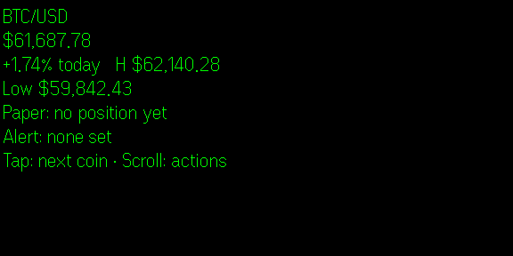
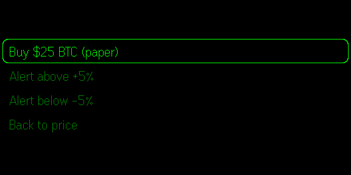
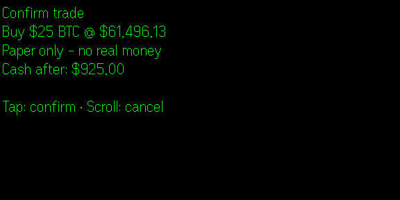
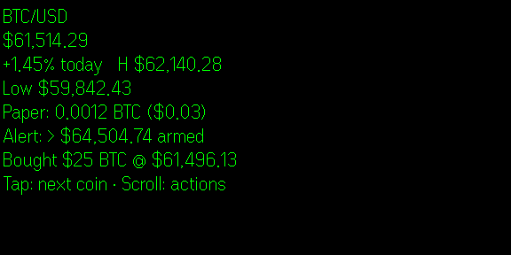

# Glance — live crypto prices for Even G2

**Track 03 · Exchanges & Stocks** — Heads Up: Even Realities Hackathon (Nov 23–29, 2026)

## The problem

You are in a trade, a meeting, or a taxi, and you want to know one thing:
what is Bitcoin doing *right now* — and did it cross the level you care about?
Pulling out your phone breaks the moment. A glance should be enough.

## What Glance does

Glance puts a live crypto price on the G2 display, one coin at a time, in
words big enough to read at a glance:

- **Live price, 24h change, 24h high/low** for BTC, ETH and SOL — real
  market data, refreshed every 5 seconds.
- **Tap** the glasses to switch coins. **Scroll up** to go back.
- **Scroll down** for actions: paper-buy $25, paper-sell $25, arm a price
  alert (+5% / −5%), clear an alert. Actions are a list — scroll to pick,
  tap to choose.
- **Trades ask first.** Buying or selling opens a confirm screen showing
  the exact price and the cash left after the trade — tap to confirm,
  scroll to cancel. A stray tap can never move (paper) money.
- **Alerts fire on the glasses**: when a price crosses an armed level, the
  display switches to a full-screen alert. Tap to dismiss.
- **Paper portfolio**: every trade is pretend money ($1,000 starting cash),
  stored on the device. Position and P&L are shown under the price.

No account, no sign-in, no API keys. The app works the moment it opens.

## Screenshots

Captured from the official Even Hub simulator (v0.9.5) via its automation
API — the raw RGBA framebuffer composited on black, exactly as the lens
shows it. Live Coinbase prices, Nov 27, 2026.

| BTC home | Actions list |
| --- | --- |
|  |  |

| Confirm a trade | After the buy |
| --- | --- |
|  |  |

## Demo video

`demo.mp4` — 53 seconds, recorded in the official simulator (see
`demo-record.sh` to re-record). It walks the whole loop: BTC → ETH →
SOL → actions → buy with confirm → alert armed. Under the 3-minute
submission limit.

## Setup

Prerequisites: Node.js 20+ and npm.

```bash
npm install
npm run dev        # Vite dev server on http://localhost:5173
```

In a second terminal:

```bash
npm run simulate   # evenhub-simulator http://localhost:5173
```

The simulator opens a 576×288 green canvas. Click the canvas to tap,
use the simulator's Up/Down controls to scroll, double-click to exit.

On real G2 glasses (optional — no glasses needed for this hackathon):

```bash
npx evenhub qr --url http://<your-lan-ip>:5173
```

Scan the QR with the Even Realities app. Hot-reload still works.

## Package

```bash
npm run build
npm run pack       # produces glance.ehpk (optional for submission)
```

## Demo script (60 seconds)

1. App opens on BTC — live price, +/−% today, high/low.
2. Tap: ETH appears. Tap: SOL appears. Tap: back to BTC. (Real data, no mocks.)
3. Scroll down: the actions list. Pick "Buy $25 BTC (paper)" — a confirm
   screen shows the exact price and cash after the trade. Tap to confirm:
   the home screen shows the position and P&L.
4. Scroll down again, pick "Alert above +5%" — the home screen now shows
   the armed alert.
5. Double-tap: the system exit dialog appears.

## Data & money safety

- **Read-only public data.** Prices come from Coinbase public market
  data (`api.coinbase.com` spot price, `api.exchange.coinbase.com`
  24h stats). Both are free, keyless, and CORS-enabled, so the app
  calls them directly from the WebView — no backend, no secrets.
- **Paper trading only.** Buys and sells move pretend dollars in
  localStorage. The app never holds user funds, never places real
  orders, and gives no financial advice.
- **No keys committed.** There are no API keys, tokens or secrets in
  this repo — there is nothing to leak.

## What existed before Nov 23, 2026

Nothing of this app. It was built fresh during the hackathon week
(Nov 27, 2026) from Even Realities' official `minimal` starter
template (`even-realities/evenhub-templates/minimal`), which supplies
the Vite + TypeScript scaffold, the SDK wiring and the `app.json`
shape. All app code in `src/` (price client, paper portfolio,
screens, event routing) is new.

## Reused open-source work

- **Starter template** — Even Realities' official `minimal` scaffold
  (`even-realities/evenhub-templates/minimal`, MIT, © 2026 David Yu /
  Even Realities). Used verbatim as the starting point (commit
  `2855826`); the scaffold's tap-counter demo was replaced by Glance.
  The other three official scaffolds (`asr`, `image`, `text-heavy`)
  were read, not used.
- **SDK + tools** — `@evenrealities/even_hub_sdk` 0.0.10 and the
  `evenhub` CLI 0.2.0 / `evenhub-simulator` 0.9.5 from npm.
- **Patterns, no code** — `goodrahstar/evenhub-g2-skill` (MIT) was
  read for hard-won rules and confirmed our implementation already
  follows them: double-tap is exit-only via `shutDownPageContainer(1)`,
  `CLICK_EVENT` arrives with `eventType` undefined (resolved inside
  the envelope check), exactly one container with `isEventCapture: 1`,
  store screenshots must come from the simulator (ours do).
- **Competitors studied, nothing copied** — two public pre-hackathon
  prototypes in the same space were read for comparison
  (`zynthlabsio/cryptoglance-even-realities` and
  `pikrimahardhika-alt/even-market-glance`; both carry no license, so
  no code could be reused). One genuine gap found and fixed: both
  rivals confirm money actions before executing them, so Glance now
  shows a trade-confirm screen too. Their contextual-menu markers need
  SDK 0.0.16; Glance stays on the 0.0.10 SDK its build was verified
  against, and reaches the same actions through its list screen.

## APIs used

- Coinbase — public spot price + 24h stats (Track 03 listed app).
  Fallback considered: OKX public ticker (also Track 03) — rejected
  because it sends no CORS headers, so a WebView cannot call it
  directly. Binance and Bybit public APIs are geo-blocked from the
  build machine (HTTP 451 / 403).

## Feature requests (things the Even Hub APIs are missing)

1. A long-press / contextual-menu event in the SDK, so actions do not
   need a separate list screen.
2. Font-size control for text containers — one big price number wants
   a large-size option instead of fixed-size text.
3. A background notify API: an app that is not open cannot show a
   price alert, which is exactly when an alert matters most.
4. A fill/background option for containers, so an alert screen can
   invert or highlight instead of plain text.
5. Faster image-container refresh, so a live sparkline is practical
   over BLE (today it is too slow to redraw every tick).

## Files

| File | Purpose |
|---|---|
| `index.html` | WebView host page. |
| `src/main.ts` | Screens, event routing, poll loop. |
| `src/data.ts` | Coinbase public API client + formatting. |
| `src/store.ts` | Paper portfolio + alerts (localStorage). |
| `app.json` | Even Hub manifest (network permission whitelists the two Coinbase hosts). |
| `vite.config.ts` | Dev server on port 5173. |
| `test/sim-test.py` | Simulator end-to-end test (10 checks, screenshots). |
| `test/logic.test.ts` | Unit tests for paper trades + alerts (20 checks). |
| `test-run.sh` | One-command simulator test run (Xvfb + Vite + simulator + test). |
| `demo-record.sh` | Records `demo.mp4` in the simulator (53s). |
| `screenshots/` | Simulator captures (raw RGBA + `-view` composites). |
| `demo.mp4` | Demo video for the submission (53s, 1280×800, h264). |

## License

MIT — see `LICENSE`.
