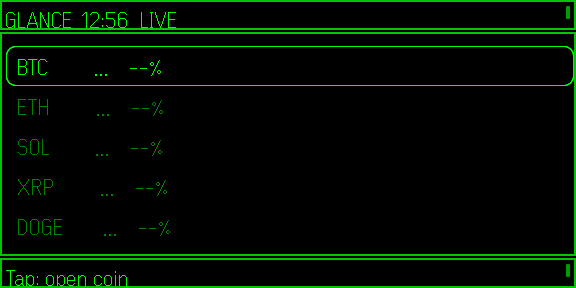
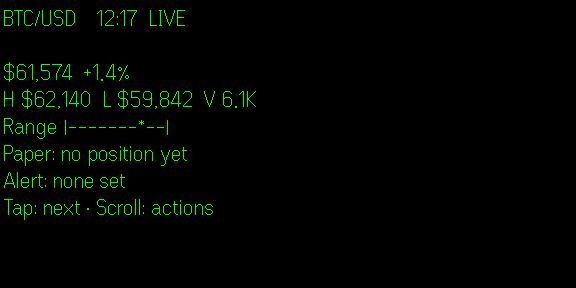
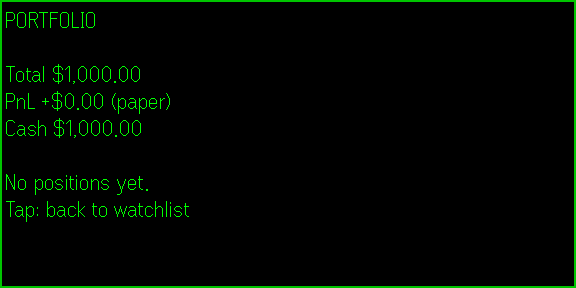
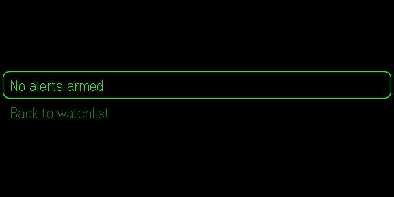
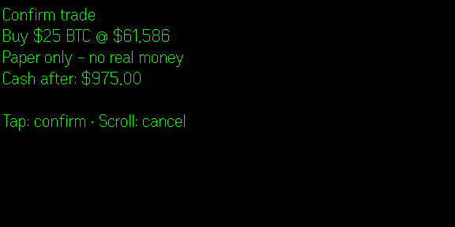
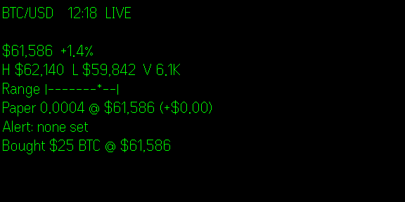

# Glance — live crypto prices for Even G2

**Track 03 · Exchanges & Stocks** — Heads Up: Even Realities Hackathon (Nov 23–29, 2026)

## The problem

You are in a trade, a meeting, or a taxi, and you want to know one thing:
what is Bitcoin doing *right now* — and did it cross the level you care about?
Pulling out your phone breaks the moment. A glance should be enough.

## What Glance does

Glance puts a live crypto price on the G2 display, one coin at a time, in
words big enough to read at a glance:

- **Watchlist home**: all five coins at a glance — BTC, ETH, SOL, XRP,
  DOGE — each with live price and 24h change, plus the portfolio total
  and the alert count. Scroll to move the `>` cursor, tap to open a row.
- **Live price, 24h change, 24h high/low, volume and 24h range** for the
  open coin — real market data, refreshed every 5 seconds. The range bar
  (`Low |----*-----| High`) shows where the price sits in its day.
- **Tap** the glasses to switch coins. **Scroll up** for the watchlist.
- **Scroll down** for actions: paper-buy $25, paper-sell $25, arm a price
  alert (±1% / ±5%, above or below), clear an alert. Actions are a list —
  scroll to pick, tap to choose.
- **Trades ask first.** Buying or selling opens a confirm screen showing
  the exact price and the cash left after the trade — tap to confirm,
  scroll to cancel. A stray tap can never move (paper) money.
- **Alerts fire on the glasses**: when a price crosses an armed level, the
  display switches to a full-screen alert. Tap to dismiss. An **alerts
  list** shows every armed alert and lets you delete one.
- **Portfolio screen**: total value, P&L against the $1,000 start, cash,
  and every position with quantity, value, average cost and P&L.
- **Paper portfolio**: every trade is pretend money ($1,000 starting cash),
  stored on the device (bridge storage first, localStorage fallback).
  Position, average cost and P&L are shown under the price.
- **Never goes blank**: Coinbase is the primary source, CoinGecko is the
  fallback, and a last-good quote is kept and marked STALE with its age.
  The header always shows the clock and a LIVE/STALE tag.

No account, no sign-in, no API keys. The app works the moment it opens.

## Typography — the premium look, honestly

Real finance apps split type in two: a clean geometric sans for labels
(CoinbaseSans, BinanceNova, SF Pro, Inter) and a **mono/tabular face for
every number** (CoinbaseMono, BinancePlex, `tabular-nums`), with a big
price figure and strict size hierarchy. Glance brings that feel to G2 —
within what the hardware allows.

The honest limit, verified against the shipped SDK: `TextContainerProperty`
in SDK 0.0.10 exposes **no font, size or colour field** (grepped the
type definitions and the compiled JS — zero font identifiers), and the
glasses firmware renders every text container in its single built-in face
at one fixed size. A bundled webfont cannot reach the glasses at all:
the display is drawn by the Even App from SDK containers, not from the
WebView DOM. So no font file is swapped — none can be.

What *is* changed, and visible in every screenshot: the firmware face is
monospace-like, which is the tabular face for free. Glance leans into it
with the Bloomberg-terminal discipline — **adaptive decimals** (big prices
drop the cents, sub-dollar coins get 4dp), **signed 1-decimal percentages**,
**padded aligned columns** on the watchlist so a ticking price never
jitters its column, **caps labels**, a **clock + LIVE/STALE tag**, and a
**hero price isolated by a blank line** so it reads as the big figure
even at a fixed glyph size. When you cannot change the face, you win on
grid, rhythm and tabular discipline. (Full write-up: `compare-v2.md`.)

## Screenshots

Captured from the official Even Hub simulator (v0.9.5) via its automation
API — the raw RGBA framebuffer composited on black, exactly as the lens
shows it. Live Coinbase prices, Nov 27, 2026.

| Watchlist home | BTC detail |
| --- | --- |
|  |  |

| Portfolio | Alerts list |
| --- | --- |
|  |  |

| Confirm a trade | After the buy |
| --- | --- |
|  |  |

## Demo video

`demo.mp4` — ~85 seconds, recorded in the official simulator (see
`demo-record.sh` to re-record). It walks the whole loop: watchlist →
BTC → ETH → SOL → XRP → watchlist → portfolio → alerts list → actions →
buy with confirm → ±1% alert armed. Under the 3-minute submission limit.

## Setup

Prerequisites: Node.js 20+ and npm.

```bash
npm install
npm run dev        # Vite dev server on http://localhost:5173
```

In a second terminal:

```bash
npm run simulate   # evenhub-simulator http://localhost:5173
```

The simulator opens a 576×288 green canvas. Click the canvas to tap,
use the simulator's Up/Down controls to scroll, double-click to exit.

On real G2 glasses (optional — no glasses needed for this hackathon):

```bash
npx evenhub qr --url http://<your-lan-ip>:5173
```

Scan the QR with the Even Realities app. Hot-reload still works.

## Package

```bash
npm run build
npm run pack       # produces glance.ehpk (optional for submission)
```

## Demo script (~85 seconds)

1. App opens on the **watchlist** — five coins with live prices and 24h
   changes, portfolio total, alert count.
2. Tap: BTC detail (price, change, high/low/volume, range bar). Tap: ETH.
   Tap: SOL. Tap: XRP. Scroll up: back to the watchlist. (Real data.)
3. Scroll down to the Portfolio row, tap: total value, P&L, cash,
   positions. Tap: back to the watchlist.
4. Scroll down to the Alerts row, tap: the alerts list. Tap: back.
5. Tap BTC, scroll down: the actions list. Pick "Buy $25 BTC (paper)" —
   a confirm screen shows the exact price and cash after the trade. Tap
   to confirm: the coin screen shows the position, average cost and P&L.
6. Scroll down again, pick "Alert above +1%" — the coin screen now shows
   the armed alert.
7. Double-tap: the system exit dialog appears.

## Data & money safety

- **Read-only public data.** Prices come from Coinbase public 24h stats
  (`api.exchange.coinbase.com`, one request per coin; the stats `last`
  field is the latest price). **CoinGecko public markets**
  (`api.coingecko.com`) is the fallback for any coin Coinbase fails to
  return. Both are free, keyless, and CORS-enabled, so the app calls
  them directly from the WebView — no backend, no secrets. A last-good
  quote is kept and marked STALE (with its age) instead of going blank.
- **Paper trading only.** Buys and sells move pretend dollars, stored in
  bridge storage when available (localStorage fallback). The app never
  holds user funds, never places real orders, and gives no financial
  advice.
- **No keys committed.** There are no API keys, tokens or secrets in
  this repo — there is nothing to leak.

## What existed before Nov 23, 2026

Nothing of this app. It was built fresh during the hackathon week
(Nov 27, 2026) from Even Realities' official `minimal` starter
template (`even-realities/evenhub-templates/minimal`), which supplies
the Vite + TypeScript scaffold, the SDK wiring and the `app.json`
shape. All app code in `src/` (price client, paper portfolio,
screens, event routing) is new. v2 (this version) revises the submitted
v1 — watchlist, portfolio screen, alerts list, data fallback, two more
coins, ±1% alerts, bridge storage, and the typographic treatment —
still inside the Nov 23–29 build window.

## Reused open-source work

- **Starter template** — Even Realities' official `minimal` scaffold
  (`even-realities/evenhub-templates/minimal`, MIT, © 2026 David Yu /
  Even Realities). Used verbatim as the starting point (commit
  `2855826`); the scaffold's tap-counter demo was replaced by Glance.
  The other three official scaffolds (`asr`, `image`, `text-heavy`)
  were read, not used.
- **SDK + tools** — `@evenrealities/even_hub_sdk` 0.0.10 and the
  `evenhub` CLI 0.2.0 / `evenhub-simulator` 0.9.5 from npm.
- **Patterns, no code** — `goodrahstar/evenhub-g2-skill` (MIT) was
  read for hard-won rules and confirmed our implementation already
  follows them: double-tap is exit-only via `shutDownPageContainer(1)`,
  `CLICK_EVENT` arrives with `eventType` undefined (resolved inside
  the envelope check), exactly one container with `isEventCapture: 1`,
  store screenshots must come from the simulator (ours do).
- **Competitors studied; patterns adapted, attributed** — two public
  pre-hackathon prototypes in the same space were read in full for
  comparison (see `compare-v2.md` for the gap analysis):
  `zynthlabsio/cryptoglance-even-realities` (**MIT**) and
  `pikrimahardhika-alt/even-market-glance` (**no license — patterns
  only, no code**). Adapted from CryptoGlance, with attribution here:
  the watchlist-home layout, the portfolio and alerts screens, the
  header/footer zones, the multi-tier data fallback with a DEMO/STALE
  tag, the adaptive-decimal price formatting, and bridge-first storage.
  Adapted from Market Glance as patterns: the stats-only fetch (one
  request per coin), the 24h range position, compact volume, the as-of
  timestamp with STALE flag, and the ±1% alert markers. All of it was
  reimplemented in Glance's own code; no rival file was copied. Their
  contextual-menu markers need SDK 0.0.16; Glance stays on the 0.0.10
  SDK its build was verified against, and reaches the same actions
  through its list screen.
- **Real-app typography references** — BinancePlex / CoinbaseMono /
  Inter / SF Pro tabular-numerals practice (see the Typography section
  above and `compare-v2.md`). No font file is bundled: the G2 firmware
  font is fixed, so the treatment is layout + tabular formatting.

## APIs used

- Coinbase — public 24h stats (Track 03 listed app), one request per
  coin; the stats `last` field is the latest price.
- CoinGecko — public markets endpoint, one call for every coin Coinbase
  failed to return (fallback only).
- Fallbacks considered and rejected: OKX public ticker (also Track 03)
  — sends no CORS headers, so a WebView cannot call it directly.
  Binance and Bybit public APIs are geo-blocked from the build machine
  (HTTP 451 / 403).

## Feature requests (things the Even Hub APIs are missing)

1. A long-press / contextual-menu event in the SDK, so actions do not
   need a separate list screen.
2. Font-size control for text containers — one big price number wants
   a large-size option instead of fixed-size text. (Verified: SDK
   0.0.10 exposes no font/size/colour field at all; the glasses
   firmware renders one fixed face. See `compare-v2.md`.)
3. A background notify API: an app that is not open cannot show a
   price alert, which is exactly when an alert matters most.
4. A fill/background option for containers, so an alert screen can
   invert or highlight instead of plain text.
5. Faster image-container refresh, so a live sparkline is practical
   over BLE (today it is too slow to redraw every tick).

## Files

| File | Purpose |
|---|---|
| `index.html` | WebView host page. |
| `src/main.ts` | Screens, event routing, poll loop. |
| `src/data.ts` | Coinbase + CoinGecko clients, formatting, range bar. |
| `src/store.ts` | Paper portfolio + alerts (bridge storage, localStorage fallback). |
| `compare-v2.md` | v2 gap analysis vs rivals + real apps (incl. typography). |
| `app.json` | Even Hub manifest (network permission whitelists Coinbase + CoinGecko). |
| `vite.config.ts` | Dev server on port 5173. |
| `test/sim-test.py` | Simulator end-to-end test (17 checks, screenshots). |
| `test/logic.test.ts` | Unit tests for paper trades + alerts + formatting (44 checks). |
| `test-run.sh` | One-command simulator test run (Xvfb + Vite + simulator + test). |
| `demo-record.sh` | Records `demo.mp4` in the simulator (~85s). |
| `screenshots/` | Simulator captures (raw RGBA + `-view` composites). |
| `demo.mp4` | Demo video for the submission (~85s, 1280×800, h264). |

## License

MIT — see `LICENSE`.
